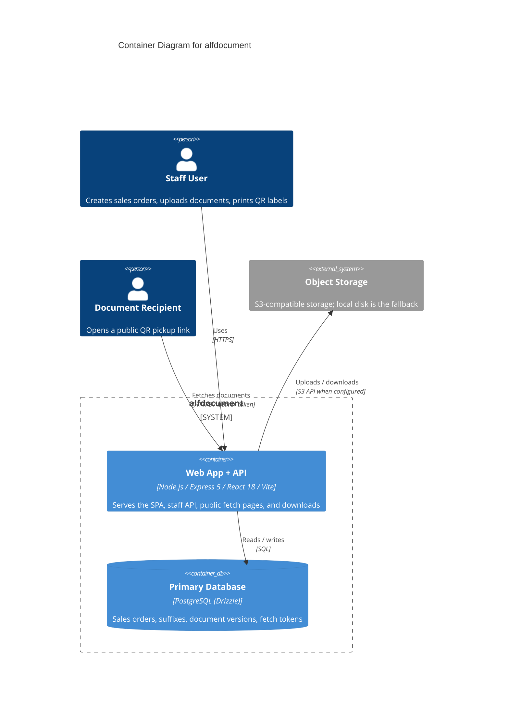

# Container Diagram — alfdocument

> **C4 Level 2** — the system broken down into deployable/runnable containers. Audience: the dev team.

## Diagram

> **Note**: this diagram was auto-generated by `/handover` on 2026-11-25 from repo signals (`package.json`, `server/index.ts`, `shared/schema.ts`, `server/storage.ts`, and `vite.config.ts`). It is a **starting point** — review and refine it.
>
> Container labels and inferred relationships may need adjustment. Local disk is an in-container fallback, not a separate deployed service. External storage is shown only for the configured S3-compatible path.

## Maintenance

One Express process serves the API and compiled React SPA. Update this diagram when a worker, cache, queue, separate frontend deployment, or managed session store is added.
