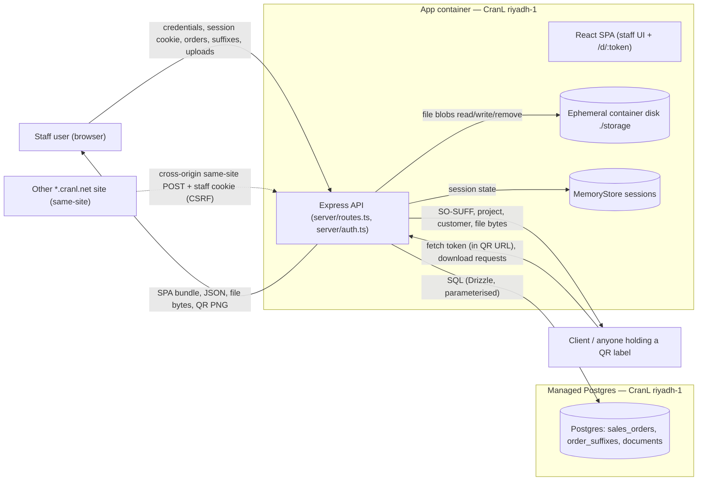

# alfdocument — Data Flow Diagram

Single-service DFD for `baratsamara/alfdocument` at `main` 91d3a5a. Source of truth for `/threat-model` and `/compliance-check`.

## Diagram

## Trust boundaries

| Crossing | From → To | Auth | Data crossing | Classification |
|---|---|---|---|---|
| B1 | Staff browser → API | Session cookie (HttpOnly, Secure, SameSite=Lax), single shared account | Credentials, order/suffix data, uploaded documents | secrets, internal |
| B2 | Client → API (public) | Bearer fetch token in URL path (192-bit), no expiry, printed on pallet labels | Token, SO-SUFF, project, customer, document bytes | internal (customer-facing) |
| B3 | Other `*.cranl.net` site → API | None beyond the staff cookie (cranl.net not on the Public Suffix List, so same-site) | Forged POST bodies | — |
| B4 | API → Postgres | DATABASE_URL credentials, internal network | All business records | internal |
| B5 | API → container disk | None (same process) | Document blobs | internal |

## Data classifications

| Element | Classification | Source |
|---|---|---|
| STAFF_PASSWORD_HASH / SALT, SESSION_SECRET | secrets | `.env.example`, CranL env |
| DATABASE_URL | secrets | CranL env |
| fetch_token | secrets (bearer) | `shared/schema.ts` order_suffixes.fetch_token |
| customer, project_name, order_number | internal (business) | `shared/schema.ts` sales_orders |
| documents (blobs) | internal (customer-facing) | `server/storage.ts` |

No PII or PCI fields detected.

---
Generated by /dfd on 2026-11-19
