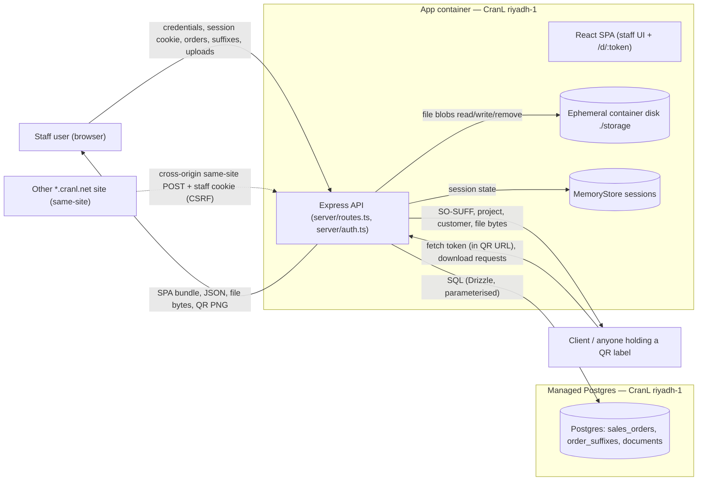

## DFD (snapshot as of 2026-11-19)

> Point-in-time capture of projects/alfdocument/architecture/dfd.md. Re-run /threat-model to refresh.

## Diagram

## Trust boundaries

| Crossing | From → To | Auth | Data crossing | Classification |
|---|---|---|---|---|
| B1 | Staff browser → API | Session cookie (HttpOnly, Secure, SameSite=Lax), single shared account | Credentials, order/suffix data, uploaded documents | secrets, internal |
| B2 | Client → API (public) | Bearer fetch token in URL path (192-bit), no expiry, printed on pallet labels | Token, SO-SUFF, project, customer, document bytes | internal (customer-facing) |
| B3 | Other `*.cranl.net` site → API | None beyond the staff cookie (cranl.net not on the Public Suffix List, so same-site) | Forged POST bodies | — |
| B4 | API → Postgres | DATABASE_URL credentials, internal network | All business records | internal |
| B5 | API → container disk | None (same process) | Document blobs | internal |

## Data classifications

| Element | Classification | Source |
|---|---|---|
| STAFF_PASSWORD_HASH / SALT, SESSION_SECRET | secrets | `.env.example`, CranL env |
| DATABASE_URL | secrets | CranL env |
| fetch_token | secrets (bearer) | `shared/schema.ts` order_suffixes.fetch_token |
| customer, project_name, order_number | internal (business) | `shared/schema.ts` sales_orders |
| documents (blobs) | internal (customer-facing) | `server/storage.ts` |

No PII or PCI fields detected.

---

## Attack surface

3 entry-point classes (staff browser, public token holder, same-site third-party origin), 3 data stores (Postgres, container disk, MemoryStore), 0 external integrations.

## Threats by STRIDE category

| # | Category | Threat | Severity | Entry point | Mitigation |
|---|---|---|---|---|---|
| T1 | Tampering | CSRF on every POST write; cranl.net is not on the Public Suffix List, so any *.cranl.net site is same-site and SameSite=Lax sends the staff cookie. Proven locally with a foreign Origin: order create, suffix create, PDF planted in a room (multipart is CORS-safelisted), QR token rotated. Suffix ids are sequential. | high | POST /api/sales-orders, /suffixes, /documents, /rotate-token | Reject state-changing requests whose Origin (or Sec-Fetch-Site) is not the app's own origin; drop express.urlencoded; long-term custom domain + CSRF token |
| T2 | Denial of service / Tampering | No S3_* vars, no volume: blobs live on ephemeral container disk; every redeploy wipes them. Confirmed live: staging doc 1177700-20 MO_quraini_is_the_best.pdf returns 410 | high | Storage layer | Provision a CranL bucket, set S3_* env, block deploy when NODE_ENV=production without S3 config |
| T3 | Information disclosure | Staging staff password and session secret were printed into the agent chat transcript | medium | Ops | Rotate STAFF_PASSWORD_SALT/HASH and SESSION_SECRET; deliver creds out of band |
| T4 | Repudiation | Single shared 'staff' account; no audit log of create, delete, rotate | medium | All staff routes | Per-user accounts; append-only audit_log table (actor, action, target, ts) |
| T5 | Denial of service | Public download readFile-buffers whole file (up to 50MB); no rate limit on public routes; any label holder can loop it. Upload memoryStorage buffers up to 10x50MB | medium | GET /api/fetch/:token/files/:id, POST documents | Stream blobs; per-IP rate limit on /api/fetch/*; disk/S3 streaming uploads or lower limits |
| T6 | Repudiation / detection | Missing-blob 410 path is not logged; since GH-28 clients see 'No file is uploaded yet', masking data loss | medium | GET /api/fetch/:token/files/:id | console.error with doc id + storage key on 410; alert on rate |
| T7 | Spoofing / DoS | Login throttle keyed on req.ip with trust proxy 1; spoof-resistant only with exactly one proxy hop (unverified on CranL); counts successful logins | low | POST /api/login | Verify hop count; count failures only |
| T8 | Tampering | No HSTS, no CSP | low | All responses | HSTS max-age>=6 months; restrictive CSP |
| T9 | Tampering (integrity) | UTF-8 filenames decoded as latin1 by multer: Arabic names stored and shown as mojibake | low | POST documents | multer defParamCharset 'utf8'; RFC 5987 filename* on download |
| T10 | Spoofing | No absolute session lifetime; MemoryStore | low | Session layer | cookie maxAge + rolling idle timeout; Postgres-backed store |
| T11 | Tampering (supply chain) | CI actions referenced by tag, not SHA; 4 moderate dev-only esbuild advisories via drizzle-kit | low | .github/workflows/ci.yml | Pin action SHAs; track drizzle-kit upgrade |
| T12 | Information disclosure | Fetch token is a permanent bearer credential printed on pallets; appears in proxy access logs | info | QR labels | Accepted; rotation exists |

Summary: 12 threats (0 critical, 2 high, 4 medium, 5 low, 1 info).

## Recommended priority

1. T2: move blobs to object storage before any further real use (data loss happening now)
2. T1: Origin check on writes + remove urlencoded parser
3. T3: rotate staging credentials
4. T6: log the missing-blob path
5. T5, T4, then lows

## OWASP cross-check

- Injection: Drizzle parameterised everywhere; storage keys sanitised. Pass.
- XSS: React escaping, no dangerouslySetInnerHTML; server HTML page escapes (escHtml). Pass.
- Access control: every staff route behind requireStaff; public routes double-scoped by token + suffix; PATCH/DELETE preflight-blocked cross-origin. Pass, except T1.
- Misconfiguration: JSON-only errors, nosniff, frame-options, no source maps, http->https redirect. HSTS/CSP missing (T8).
- Components: npm audit --omit=dev 0 vulns; 4 moderate dev-only.
