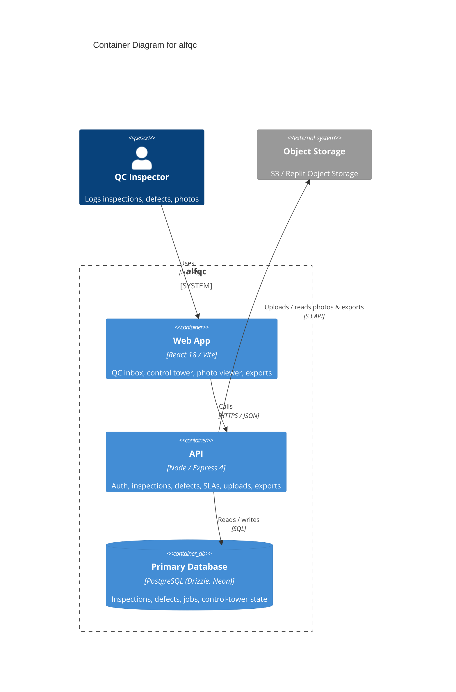

# Container Diagram — alfqc

> **C4 Level 2** — the system broken down into deployable/runnable containers. Audience: the dev team.

## Diagram

> **Note**: this diagram was auto-generated by /handover on 2026-11-24 from repo signals (package.json, drizzle.config.ts, server/objectStorage.ts, vite.config.ts). It is a **starting point** — review and refine.
> - Container labels and tech strings — the detector may have picked a framework version wrong
> - Inferred relationships — user → web assumes HTTPS; adjust if your stack uses something else
> - External systems — anything your team uses that isn't in package.json (e.g. infra-only dependencies, direct cloud APIs called via HTTP) won't have been detected
> Update the "Maintenance" section below once the diagram is stable.

## Maintenance

Single deployable (Express serves API + built Vite static) plus Postgres plus object storage. Update when a worker, cache, or queue is added.
